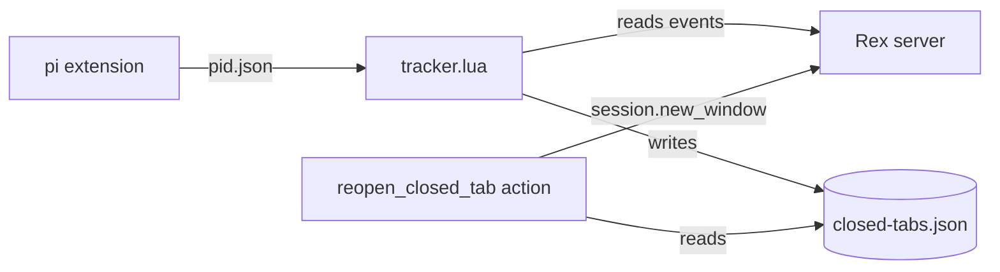

# rex-reopen-tab

**Reopen Closed Tab** for the [Rex](https://www.superlogical.com/rex) terminal: press
`cmd+shift+t` to get back the tab you closed by mistake, with its layout, its folders,
and its coding agents resumed in the same session.

Rex does not have this feature. This repo adds it with the Rex Lua API and a small
background tracker. macOS only.

## What comes back

- The tab label, the split layout, the pane labels, and the tab position.
- The folder of each pane, also after a `cd`.
- Coding agents, started again in their folder:

| Agent | When you closed the tab | Reopen runs |
| --- | --- | --- |
| Claude Code | it had a conversation | `claude <your flags> --resume <id>` |
| Codex | it had a conversation | `codex <your flags> resume <id>` |
| pi | it had a conversation | `pi <your flags> --session <file>` |
| any of them | no message sent yet | the same command, without a session (a new agent) |
| any of them | session not found | the agent's session picker |

- Other programs: the command is typed at the prompt **without Enter**. You decide whether
  to run it again.

It does **not** bring back scrollback, running processes, or an agent turn in progress.
It does not record a tab that closed because its program exited (`exit`, or the program
quit), or the tabs of a session that was killed.

## Install

```sh
git clone https://github.com/YogevKr/rex-reopen-tab.git
cd rex-reopen-tab
./install.sh
```

`install.sh`:

1. Copies `src/tracker.lua` and `src/actions.lua` to `~/.config/rex/reopen-tab/`.
2. Adds one `dofile(...)` line to your Rex `init.lua`, between marker comments.
3. Installs a LaunchAgent (`io.github.yogevkr.rex-reopen-tab`) that keeps the tracker running.
4. Copies the pi extension to `~/.pi/agent/extensions/` when pi is installed.
5. Reloads the Rex config.

Options: `--key cmd+alt+t` binds a different key (`--key ""` binds none). `--no-pi` skips
the pi extension. Run `./install.sh` again after `git pull` to update.

pi sessions that are already open do not have the extension yet. Run `/reload` in them.

## Use

- `cmd+shift+t`, or **Reopen Closed Tab** in the command palette. Each press reopens the
  next most recent tab of the current session.
- From a shell or an agent:

```sh
rex do list_closed_tabs            # closed tabs of this session, newest first
rex do reopen_closed_tab index=2   # the second most recent
rex do reopen_closed_tab any=true  # the newest from any session, into this one
```

The list keeps the last 20 closed tabs of each session.

## How it works



- **tracker.lua** runs as `rex do --all`. It keeps a copy of each session's layout and
  of each pane's foreground process and folder. When a tab closes, it writes the tab to
  `closed-tabs.json`.
- **actions.lua** runs in the Rex server (loaded by `init.lua`). `reopen_closed_tab`
  builds the tab again with `session.new_window` and types each pane's start command.
- **Agent sessions:**
  - Claude Code: `~/.claude/sessions/<pid>.json` gives the session ID. The transcript
    shows whether the session has a conversation.
  - Codex: the rollout file that Codex keeps open gives the session ID (`lsof`).
  - pi: pi does not keep its session file open. `pi-extension.ts` writes
    `~/.local/state/rex-reopen-tab/pi/<pid>.json` with the session, the folder, and pi's
    arguments.

Why a separate tracker: `rex.on` handlers in `init.lua` did not fire on a server with no
app attached. Also, when `window_closed` arrives, the server has already removed the panes,
so the tracker must know their state before the close.

### Wrappers

If you start agents through a wrapper (`<wrapper> run -- <agent args>`), add it to
`WRAPPERS` at the top of `src/tracker.lua`, and run `./install.sh` again. Reopen then
keeps the wrapper. The defaults are `tcr` (Claude) and `tcx` (Codex). `EXEC_WRAPPERS`
handles a wrapper that replaces itself with the agent and adds its own flags.

## Files and logs

| Path | Content |
| --- | --- |
| `~/.config/rex/reopen-tab/` | installed `tracker.lua` and `actions.lua` |
| `~/.local/state/rex-reopen-tab/closed-tabs.json` | closed tabs |
| `~/.local/state/rex-reopen-tab/tracker.log` | one line per recorded or skipped tab, and slow steps |
| `~/.local/state/rex-reopen-tab/actions.log` | one line per `reopen_closed_tab` run |
| `~/.local/state/rex-reopen-tab/pi/` | session of each running pi |

If a tab does not come back, read the end of `tracker.log`:

- `recorded <tab> ... panes: codex:resume` — the tab is in the list.
- `skipped <tab> ... : <reason>` — the tab was not recorded, and why.
- `slow command:` or `slow handler:` — a step held the tracker for 2 seconds or more.

Restart the tracker: `launchctl kickstart -k gui/$(id -u)/io.github.yogevkr.rex-reopen-tab`

## Known issues

- Once, the tracker stopped for about 38 seconds while a Codex started. Closes during that
  time were recorded late. The cause is not known. The slow-step log lines exist to find it.
- `ps` splits arguments on spaces, so an agent flag that contains a space comes back as
  two words.
- Claude Code asks the folder trust question again when you resume in a folder that you
  did not trust, for example `~`.
- Floating panes are not restored. Only the tiled layout is.

## Test

```sh
test/run.sh
```

The tests start an isolated Rex server in a temporary folder, so your sessions are not
touched. They cover the close orders (tab close, last-pane close, program exit, a tab
that leaves the layout before `window_closed`), the reopen command for each agent (with
fake processes), and a real shell tab that is closed and reopened in the folder after `cd`.

Tested with Rex `0.0.1792787366-g623b2d` (2026-10-23), Claude Code 2.1.302, Codex CLI
0.163.0, pi 1.4.0, and macOS 26.6.

## Uninstall

```sh
./uninstall.sh          # keeps the closed-tab list and the logs
./uninstall.sh --purge  # removes them too
```

## For the Rex team

A built-in Reopen Closed Tab would remove the need for the tracker. These points made the
add-on harder than it should be:

- `rex.on` handlers in `init.lua` do not fire when no app is attached.
- When `window_closed` arrives, `block.method` on the tab's panes returns 404.
- `rex.exec` has no timeout, and it blocks the event handlers.
- There is no Lua call to show a message; an action must fail to show one.

## License

MIT
